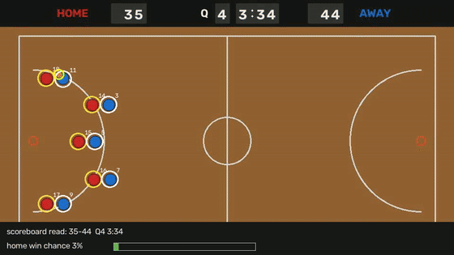
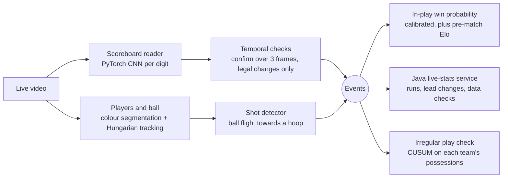
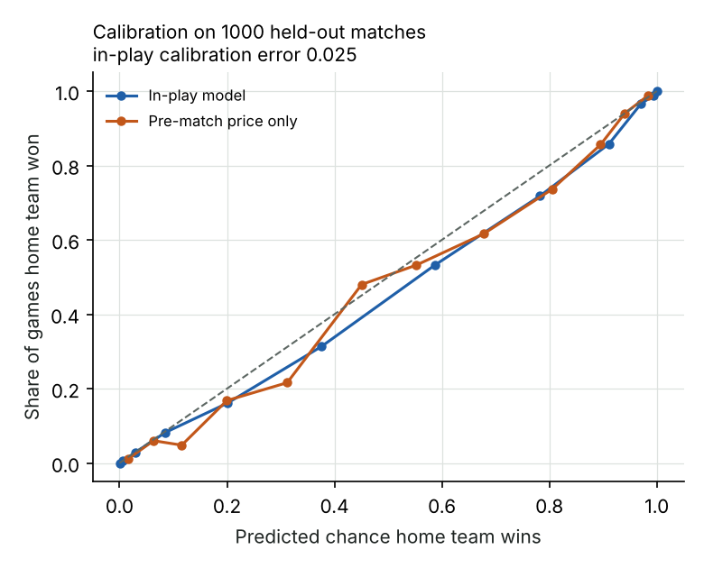
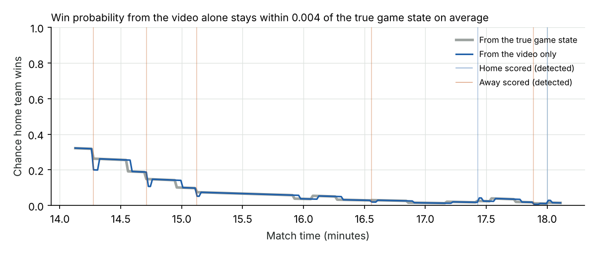

# eSports Vision

**Live event detection from esports basketball video, feeding a calibrated
in-play win probability and an integrity check.** A Python pipeline reads the
scoreboard with a small PyTorch CNN, tracks players and the ball, spots shots
and scores as they happen, and streams events to a Java service that keeps
live match statistics for other systems.

All matches and video are **made up** (rendered with exact ground truth), so
every number below can be checked frame by frame.



*Tracked players with IDs and team (rings), the ball, a detected shot, the
scoreboard reading and the live home-win chance.*

## How it works



## Results

Three test sets, each 12 minutes of video from 3 matches the models never saw
(29 score changes and 51 shots per set):

| | Same broadcast style as training | Unseen broadcast style | Unseen style and a poor-quality stream |
|---|---|---|---|
| Scoreboard digits read correctly | 100% | 100% | 99.65% |
| Score changes found | **29 / 29** | **29 / 29** | **29 / 29** |
| False score events (with temporal checks) | **0** | **0** | **0** |
| False score events without temporal checks | 16 | 16 | 674 |
| Time to confirm a score change (median / p95) | 80 / 80 ms | 80 / 80 ms | 80 / 200 ms |
| Shots found | 51 / 51 | 51 / 51 | 51 / 51 |
| Players found (precision / recall) | 99.9% / 99.8% | 99.9% / 99.8% | 88% / 93% |
| Track ID switches per 1,000 player-frames | 0.24 | 0.12 | 68 |

The "poor-quality stream" has heavy compression, a low-resolution source
scaled up, and noise. Full numbers: [reports/vision.json](reports/vision.json).

**What this shows**

- **Temporal logic matters more than the model.** Reading single frames, even
  with 99.65% of digits right, produced 674 false score events on the poor
  stream, because one misread digit is enough to fake a basket. Requiring the
  same reading for 3 frames and only legal score changes (up by 1 to 3, unless
  the scoreboard was hidden by a replay) removed all of them, for an 80 ms
  delay.
- **The digit reader generalises.** It was trained only on one scoreboard
  style but read an unseen style perfectly, because crops are converted to
  grey and contrast-stretched before the CNN sees them, and training used
  heavy augmentation.
- **Simple tracking breaks on poor video.** Colour-based detection is near
  perfect on clean frames but has many ID switches on the poor stream. On
  real footage this part would be replaced by a trained detector (see
  [the plan for real footage](docs/real-footage-plan.md)).

**Speed.** Median 7.4 ms per frame for the whole pipeline (decode, scoreboard,
detection, tracking, shots) on 2 CPU cores; p99 18 ms. The budget for live
25 fps video is 40 ms.

### In-play prices



Trained on 2,000 simulated matches, tested on 1,000 others (60,000 game states):

| Model | Log loss | Brier | Calibration error |
|---|---|---|---|
| Pre-match price only (Elo) | 0.406 | 0.131 | 0.035 |
| Score and clock only | 0.389 | 0.130 | 0.036 |
| **In-play model (score, clock, possession, pre-match rating)** | **0.286** | **0.090** | **0.025** |

Elo ratings, learned only from results, correlate 0.98 with the hidden team
strengths, so they work as pre-match prices and as an input to in-play
prices. Probabilities convert to fair decimal odds with no margin, for
example 0.874 to 1.14.



Driven only by what the pipeline read from the video, the live win
probability stayed within **0.004** of the probability from the true game
state on average (largest gap 0.064, while the possession estimate from the
ball's position lagged).

### Irregular play

Matches where one team plays far below its rating for a stretch (more
turnovers and misses) were mixed into a 2,000-match season at about 5%. A
CUSUM test on each team's possessions scored every match; the top 3% were
flagged for review:

| Length of underperformance | ROC AUC | Precision of flags | Irregular matches caught |
|---|---|---|---|
| 2.5 to 5 minutes | 0.60 | 10% | 6% |
| 5 minutes | 0.62 | 23% | 13% |
| Whole second half (10 minutes) | **0.81** | **45%** | 30% |

The honest finding: short spells of poor play cannot be told apart from bad
luck using the score alone. Longer ones can, at about 10 times the base rate.
Real integrity work would add signals only real data has (player inputs,
gamer pose from the camera, betting market moves), and every flag goes to a
person.

## Java live-stats service

`java/` holds a small service written with only the JDK (Java 21):
`POST /events` takes one JSON event per line from the Python pipeline, and
`GET /state` returns live statistics such as score, current run, best runs,
lead changes, shots and a data-quality counter. If a score event disagrees
with its own running total, it trusts the scoreboard and counts a "resync",
which tells the trading team an event was missed. It has 7 tests of its own
and a Python-to-Java integration test.

```bash
make java-run          # starts on http://127.0.0.1:8090
curl -X POST --data-binary $'{"type":"score","team":"home","points":2,"home":2,"away":0}' http://127.0.0.1:8090/events
curl http://127.0.0.1:8090/state
```

## Run it

```bash
pip install -r requirements.txt
make test         # 14 Python tests + 7 Java tests
make clips        # render the made-up match videos (a few minutes)
make vision       # train the scoreboard reader, test the pipeline
make models       # in-play model, irregular play, live chart
make demo         # annotated GIF
```

## Project layout

```
esv/
  sim.py        eBasketball match engine (possessions, shots, free throws, turnovers, irregular play)
  render.py     broadcast-style video with exact ground truth, two scoreboard styles, poor-stream mode
  hud.py        PyTorch digit CNN, scoreboard decoding, temporal score tracker
  tracking.py   player and ball detection, team grouping, Hungarian tracking, shot detection
  pipeline.py   frame-by-frame live pipeline with timing of every stage
  models.py     Elo, in-play win probability, fair odds, irregular-play CUSUM
java/           live-stats service and tests (JDK only)
scripts/        make_clips, run_vision, run_models, make_demo
reports/        results and charts
docs/           plan for real broadcasts
```

## Limits

The video is simple on purpose: players are discs on a flat court, so the
tracking results are far better than real game footage would give. The
scoreboard reader and temporal logic are the parts closest to production;
the tracker is a placeholder for a trained detector. Gamer pose estimation
is described in the plan but not built, because no suitable video could be
used here. Irregular play is simulated with one assumed pattern, and the
detector looks for that pattern.

Licence: MIT. Author: Jasper Chinedu Nwangere.
